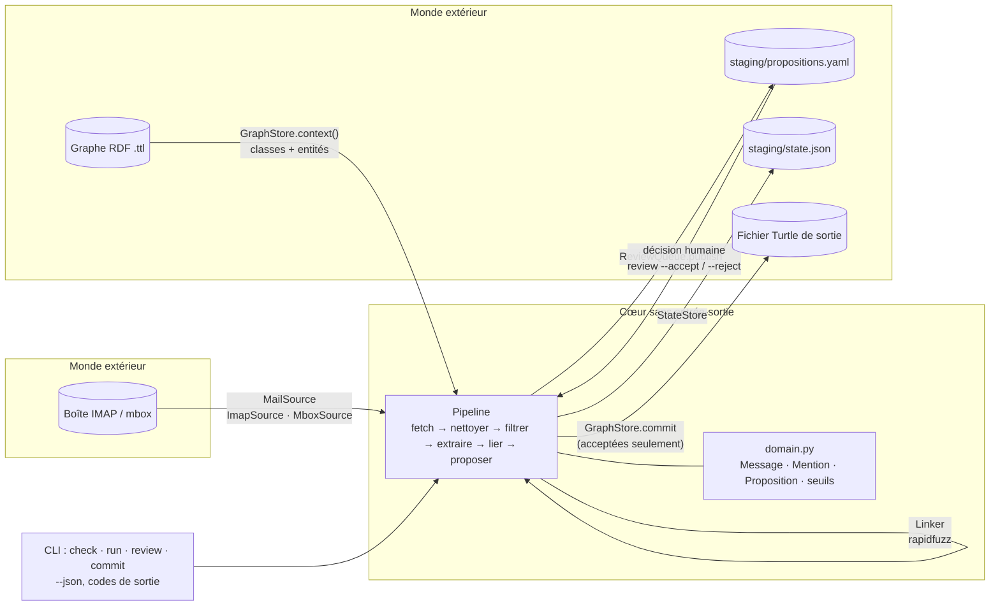
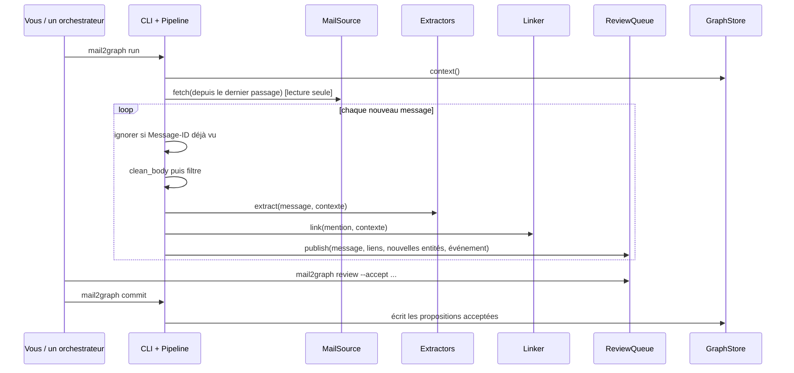
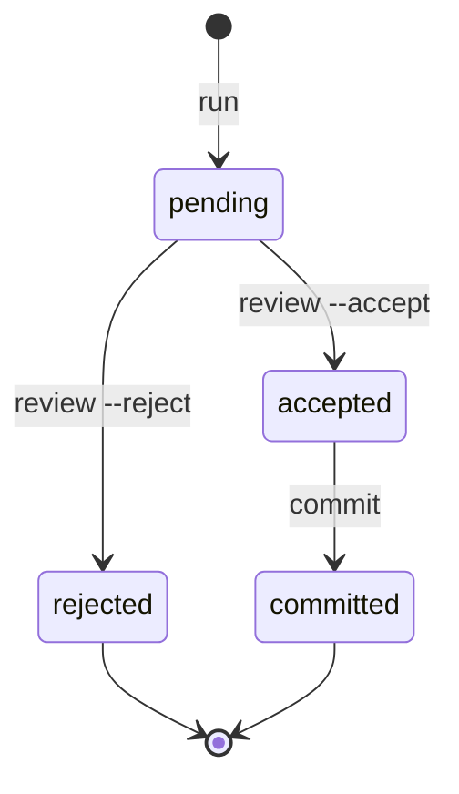

# Architecture

mail2graph suit une architecture hexagonale : le cœur ne connaît que des interfaces (les *ports*) ; les
*adaptateurs* branchent le monde extérieur (IMAP, fichiers RDF, file de relecture) et se remplacent par configuration.

```
                      ┌─────────────── cœur ───────────────┐
 MailSource  ───────▶ │ Pipeline                           │ ───────▶ ReviewQueue
 (IMAP, mbox)         │  fetch → filtrer → extraire → lier │          (YAML)
                      │  → proposer                        │
 Extractor ◀───────── │                                    │ ◀─────── décisions humaines
 (regex, gazetteer,   │ domain.py : règles pures           │
  NER, agent)         └───────────────┬────────────────────┘
 Linker (fuzzy)                       │ commit (propositions acceptées)
                                      ▼
                                  GraphStore (Turtle / rdflib)
```

## Vue d'ensemble (diagramme)



## Un passage, pas à pas



## Cycle de vie d'une proposition



Un `link`, un `event` ou un `new_entity` a pour `parent` la proposition `message` : il n'est écrit que si son courriel
est accepté. L'identifiant d'une proposition est un hachage de son contenu, donc relancer `run` ne crée aucun doublon.

## Exemple : ce que devient un courriel

| Dans le message | Résultat |
|---|---|
| « DP 029 174 26 00122 » (regex) | `link` vers l'entité du dossier, score 1,00 |
| « Mairie de Plonéour-Lanvern » (gazetteer) | `link` vers l'entité de la mairie, score 1,00 |
| Sujet et date | `message` (sujet, date, domaine de l'expéditeur, hachage) et `event` daté |
| Corps, adresse, nom | **jamais écrits** dans le graphe |

## Les ports (`src/mail2graph/ports.py`)

| Port | Rôle |
|---|---|
| `MailSource.fetch(since)` | fournit des `Message` |
| `Extractor.extract(message, ctx)` | repère des `Mention` ; plusieurs extracteurs se cumulent |
| `Linker.link(mention, ctx)` | associe une mention à des entités candidates avec un score 0..1 |
| `GraphStore.context() / commit()` | expose classes et entités ; écrit les propositions acceptées |
| `ReviewQueue` | publie, liste, décide, marque les propositions comme écrites |
| `StateStore` | mémorise les messages déjà traités (idempotence) |

## Flux

1. **fetch** : la source renvoie les messages ; ceux déjà vus (Message-ID) sont ignorés.
2. **nettoyage** : `clean_body` retire citations, en-tête de réponse et signature.
3. **filtre** : expéditeurs autorisés et motif d'objet (configuration).
4. **extraction** : chaque extracteur produit des mentions.
5. **liaison** : une mention est liée si son score dépasse `link_threshold`, signalée « incertaine » entre
   `suggest_threshold` et `link_threshold`. Sous le seuil, une mention d'une nature listée dans
   `graph.new_entity_kinds` devient une proposition de **nouvelle entité**.
6. **propositions** : `message` (le courriel), `link`, `new_entity`, `event`. Les liens et événements ont pour
   `parent` la proposition `message` : un enfant n'est écrit que si son courriel est accepté.
7. **relecture** : un humain accepte ou rejette ; **commit** écrit les propositions acceptées dans un fichier Turtle
   séparé (`graph.output_file`), jamais dans les fichiers sources du graphe.

Les identifiants de propositions sont déterministes : relancer `run` sur les mêmes messages ne duplique rien.

## Ce qui entre dans le graphe

Sujet, date, domaine de l'expéditeur, hachage de l'identifiant du message, liens vers les entités et événement daté.
Jamais le corps, l'adresse complète, ni le nom de l'expéditeur.

## Tests

Les tests utilisent `MemorySource`, un graphe Turtle minimal et les files YAML/JSON dans un dossier temporaire.
Aucun test n'ouvre de connexion réseau. Un adaptateur nouveau doit pouvoir se tester de la même manière.
